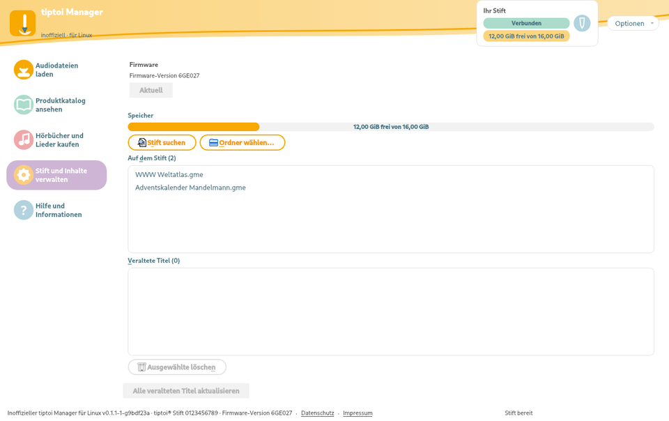
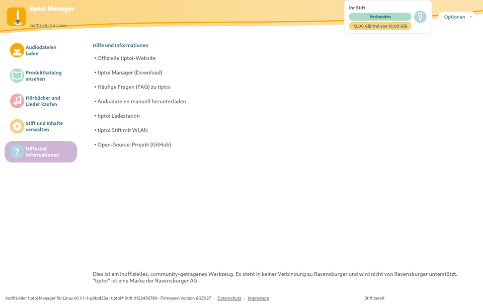

# tiptoi Manager for Linux

An unofficial, open-source manager for the Ravensburger **tiptoi** audio pen on
Linux. It mirrors the look and the everyday workflow of the official
"tiptoi Manager" (which only runs on Windows and macOS), so you can download,
browse and update the audio files for your tiptoi products without leaving
Linux.

> **This project is not affiliated with, or endorsed by, Ravensburger.**
> "tiptoi" is a trademark of Ravensburger AG.

## Screenshots

| Download & search | Catalog & category filter |
|:---:|:---:|
|  |  |

| Pen management | Product detail | Help |
|:---:|:---:|:---:|
|  |  |  |

## Features

- **Live product catalog** — browse and full-text search the complete tiptoi
  catalog with real cover art, categories (Bücher, Spiele, Puzzles,
  Adventskalender, …) and a "new titles" strip.
- **Install & verify** — download `.gme` title files (with resume) and copy them
  onto the pen, verifying the result on the device; delete titles and empty the
  pen's trash so space is really freed.
- **Outdated detection** — see which installed titles have a newer version, and
  update them all in one click.
- **Pen overview** — connected state, free space, firmware version and serial
  number, read from the pen itself.
- **Firmware updates** — download, checksum-verify and stage a firmware update
  (`update.upd`) on the pen.
- **Product detail** — large cover, category, version and a link to the product's
  own page on the Ravensburger service portal.
- **Languages** — DE/EN/FR/IT/NL. Where the wording matches the original
  application, the original wording is reused.
- **Self-update check** — quietly compares against the latest GitHub release.

## Status

Working today. See [`docs/PLAN.md`](docs/PLAN.md) for the roadmap. Explicitly
out of scope: Ravensburger account, login, purchases and WLAN-pen pairing.

## Installation

Requires Python 3.11 or newer. System requirements: `findmnt` (util-linux, to
auto-detect the pen) and `udisksctl` (udisks2, to mount/unmount it — without it
you mount the pen in your file manager instead).

> **Note:** this repository and its releases are currently **private**, so the
> AppImage is only downloadable by the account owner and the in-app version
> check stays off (the anonymous GitHub API answers 404 for private
> repositories). Making the repository public enables both with no code change.

### AppImage

Download `tiptoi_manager.AppImage` from the
[Releases](https://github.com/isengard412/tiptoi_manager_linux/releases) page, then:

```
sha256sum -c SHA256SUMS          # optional: verify the download
chmod +x tiptoi_manager.AppImage
./tiptoi_manager.AppImage
```

The AppImage bundles Python and Qt and needs nothing else. Each release is
smoke-tested on Ubuntu 22.04 and Debian 12.

### From source

```
git clone https://github.com/isengard412/tiptoi_manager_linux.git
cd tiptoi_manager_linux
pip install '.[gui]'       # installs PySide6 for the desktop app
tiptoi-gui                 # desktop app
tiptoi --help              # command line
```

## Command line

The same everyday functions are available from the shell:

```
tiptoi update                     # refresh the cached catalog
tiptoi list                       # list all products
tiptoi search "bauernhof"         # search by name (case-insensitive)
tiptoi download "<name>"          # download a title into the local cache

tiptoi pen status                 # mountpoint, free space, installed titles
tiptoi pen mount
tiptoi pen install "<name>"       # download if needed, copy to the pen, verify
tiptoi pen outdated               # installed titles with a newer version
tiptoi pen delete WN.gme          # delete by on-pen file name
tiptoi pen firmware               # show pen + latest firmware version
tiptoi pen firmware --install     # download, verify and stage the update
tiptoi pen unmount                # safe to unplug afterwards
```

Product names must match exactly as shown by `tiptoi list`; quote names that
contain spaces. Add `--pen /path/to/mountpoint` after `pen` to skip
auto-detection.

## Data & privacy

This program **collects no personal data, contains no telemetry and never
uploads anything** about you or your pen. It only connects to Ravensburger's
public servers to download the product catalog, firmware information and cover
images, which are then cached locally under `~/.cache/tiptoi-linux/`. The pen is
accessed exclusively over USB. See the in-app "Datenschutz" dialog for details.

## How it works

- The product catalog is the public `tiptoi.csv` from Ravensburger's CDN.
- Cover art is resolved by matching catalog names against the public service
  portal, then fetched from a public image CDN — nothing is bundled.
- The pen is detected by its filesystem label `tiptoi` and handled via
  `findmnt`/`udisksctl`.
- Install/delete operations write atomically and `fsync`, so an interrupted
  write never leaves a half-copied title.

## Development

```
# tests (stable shutdown-safe runner; forces an English locale)
pip install PySide6-Essentials
QT_QPA_PLATFORM=offscreen python -m tests.run

# after editing a .po file (de/fr/it/nl) recompile it, e.g.:
msgfmt -o tiptoi_linux/locale/de/LC_MESSAGES/tiptoi.mo \
          tiptoi_linux/locale/de/LC_MESSAGES/tiptoi.po

# build the AppImage (needs ImageMagick or Inkscape for the icon)
bash packaging/build-appimage.sh
bash packaging/smoke-test.sh
```

The app icon lives at `packaging/tiptoi.svg` (rendered to
`tiptoi_linux/resources/tiptoi.png`). In-app icons are drawn programmatically;
product covers are fetched at runtime.

### Releasing

Publish a release with a tag like `v0.1.0`, or go to **Actions → Release → Run
workflow** and enter a tag. The workflow runs the tests, stamps the version into
the package, builds and smoke-tests the AppImage, and attaches it to the release
together with a `SHA256SUMS` file.

## Basis & license

The functional core is based on the excellent
[tiptoi-linux](https://github.com/tokajer/tiptoi-linux) project by tokajer
(GPL-3.0). This repository is a continuation of that work with a tiptoi-Manager
look-alike UI added on top.

Licensed under GPL-3.0-or-later. See [LICENSE](LICENSE).